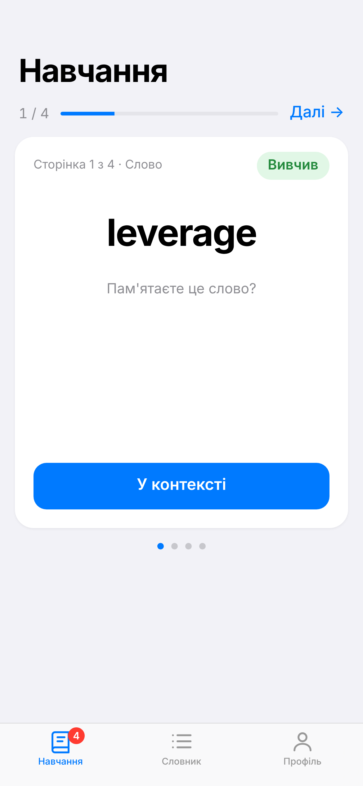
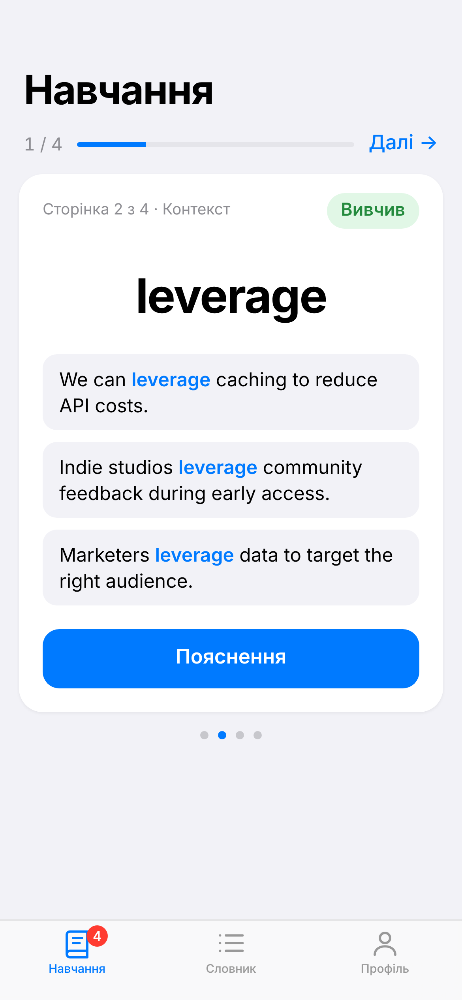
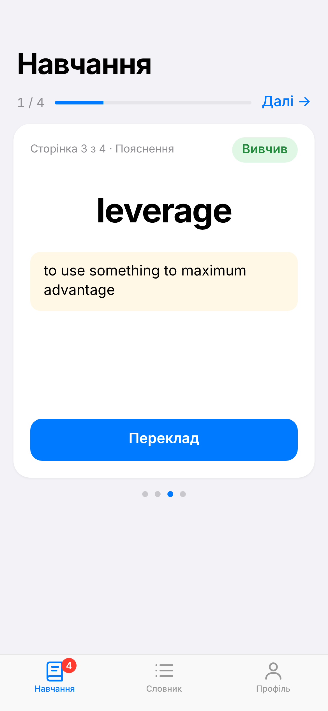
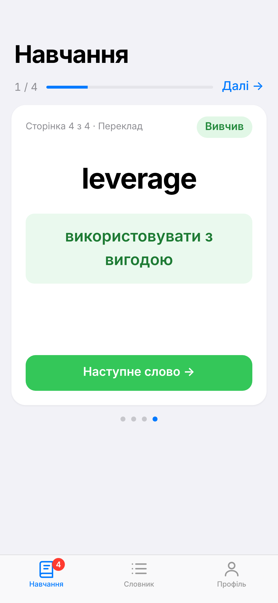
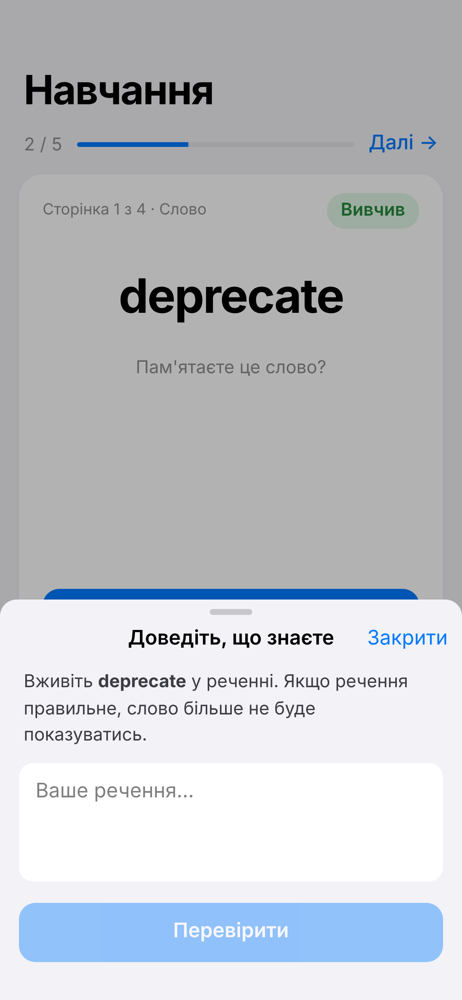
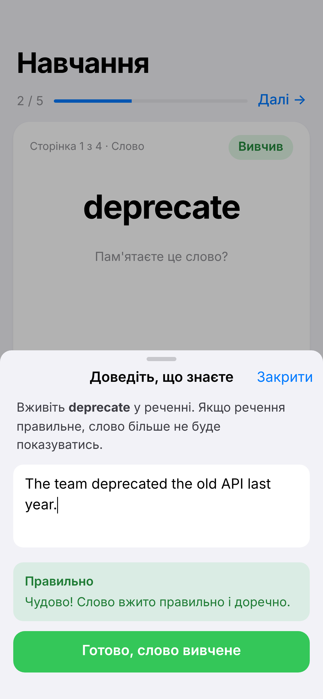
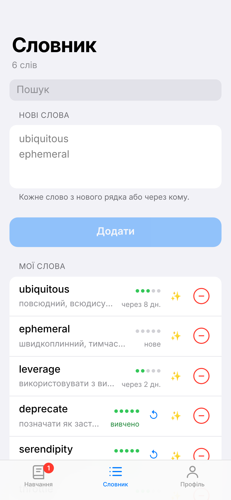
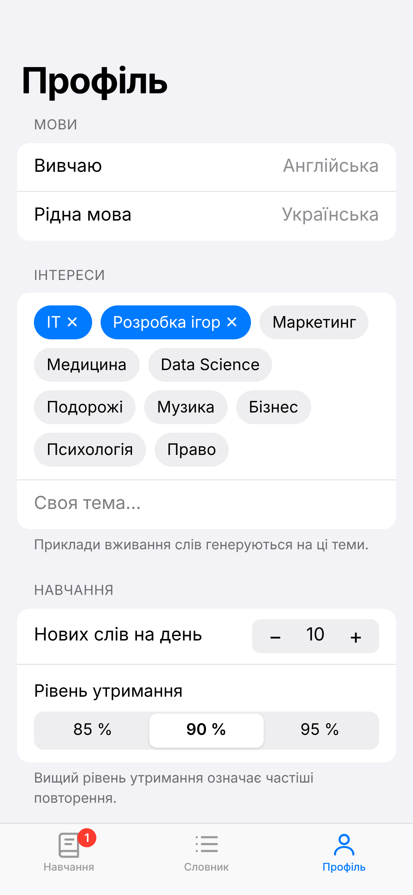

# Smart Word Learning

Прототип мобільного застосунку для персоналізованого вивчення іноземних слів:
інтервальне повторення за алгоритмом **FSRS-6**, поступові підказки
(слово → контекст → пояснення → переклад) і перевірка власного речення за допомогою LLM.

Інтерфейс оптимізовано під екран телефона (стиль iOS). Навчальне ядро (`src/core`) – чистий
TypeScript без залежності від браузера, тому без змін переноситься в мобільну збірку React Native (Expo).

## Технології

React 19 + TypeScript + Vite + Tailwind CSS · [ts-fsrs](https://github.com/open-spaced-repetition/ts-fsrs) (FSRS-6) ·
будь-яка мовна модель з OpenAI-сумісним API (OpenRouter, OpenAI, Gemini) · Vitest.

## Запуск

```bash
npm install
cp .env.example .env    # вказати ключ LLM
npm run dev             # http://localhost:5173 (у браузері – режим пристрою iPhone)
npm test                # автотести (Vitest, 48 тестів)
npm run coverage        # звіт покриття
```

Без ключа можна запустити з тестовим провайдером: `VITE_AI_PROVIDER=mock npm run dev`.

## Структура

```
src/
  core/            навчальне ядро (без UI)
    types.ts       типи: слово, стан картки FSRS, журнал повторень
    grade.ts       оцінка для FSRS за сторінкою, на якій натиснуто «Далі»
    scheduler.ts   обгортка над ts-fsrs (FSRS-6): новий стан картки, інтервал, R
    queue.ts       формування черги сесії
    session.ts     «Далі» (оцінка → FSRS → журнал) і «Вивчив» (позначка вивченого слова)
  llm/
    client.ts      клієнт OpenAI-сумісного API (провайдер = base URL + ключ + модель), mock
    service.ts     генерація контенту і перевірка речення, валідація відповіді, повторна спроба
    json.ts        розбір JSON із відповіді моделі
  ui/              екрани: Навчання, Словник, Профіль
  storage.ts       збереження на пристрої (localStorage; у мобільній збірці – SQLite)
```

## Як працює картка

Картка має 4 сторінки: **слово → у контексті → пояснення → переклад**. На будь-якій сторінці
користувач може натиснути **«Далі →»**: застосунок запам'ятовує, на якій сторінці він перейшов
до наступного слова, і за алгоритмом FSRS-6 планує наступний показ.

| Сторінка, на якій натиснуто «Далі» | Внутрішня оцінка FSRS | Наступний показ |
|---|---|---|
| 1 – лише слово | Easy | найпізніше |
| 2 – у контексті | Good | пізніше |
| 3 – пояснення | Hard | раніше |
| 4 – переклад | Again | найближчим часом (і ще раз у кінці сесії) |

Кнопка **«Вивчив»** – для слова, яке користувач знає дуже добре і не хоче більше бачити.
Щоб позначити слово вивченим, треба вжити його в реченні; речення перевіряє мовна модель.
Вивчене слово можна повернути в повторення на вкладці «Словник» (↺).

## Налаштування LLM (`.env`)

| Змінна | Призначення |
|---|---|
| `VITE_AI_PROVIDER` | `openrouter` \| `openai` \| `gemini` \| `mock` |
| `VITE_LLM_BASE_URL` | адреса OpenAI-сумісного API (за замовчуванням – за провайдером) |
| `VITE_LLM_API_KEY` | ключ API |
| `VITE_LLM_MODEL` | назва моделі |
| `VITE_LLM_REASONING_EFFORT` | для Gemini: обсяг «міркувань» моделі (за замовчуванням `low`) |

Підтримуються й старі змінні прототипу (`VITE_OPENROUTER_*`, `VITE_GEMINI_*`).

> У прототипі запит до LLM іде безпосередньо з клієнта, тому ключ потрапляє в зібраний бандл.
> Для публічного розгортання запити слід проксувати через серверний шлюз.

## Знімки екрана

| Слово | Контекст | Пояснення | Переклад |
|---|---|---|---|
|  |  |  |  |

| «Вивчив» | Перевірка речення | Словник | Профіль |
|---|---|---|---|
|  |  |  |  |
